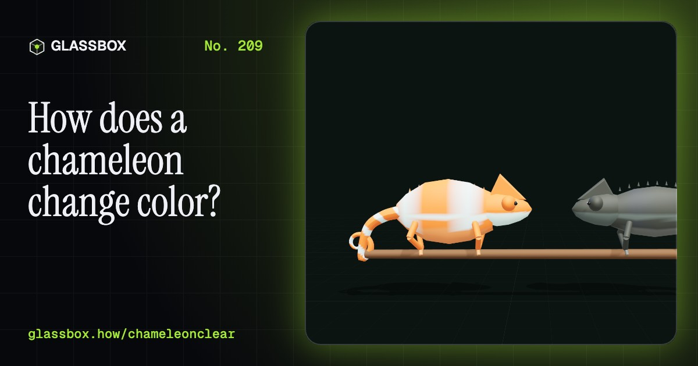
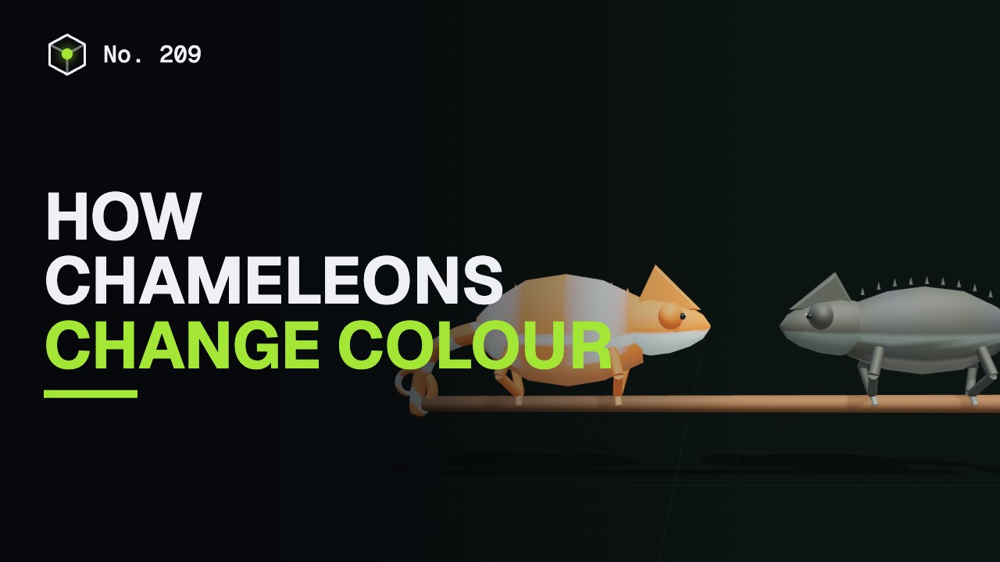
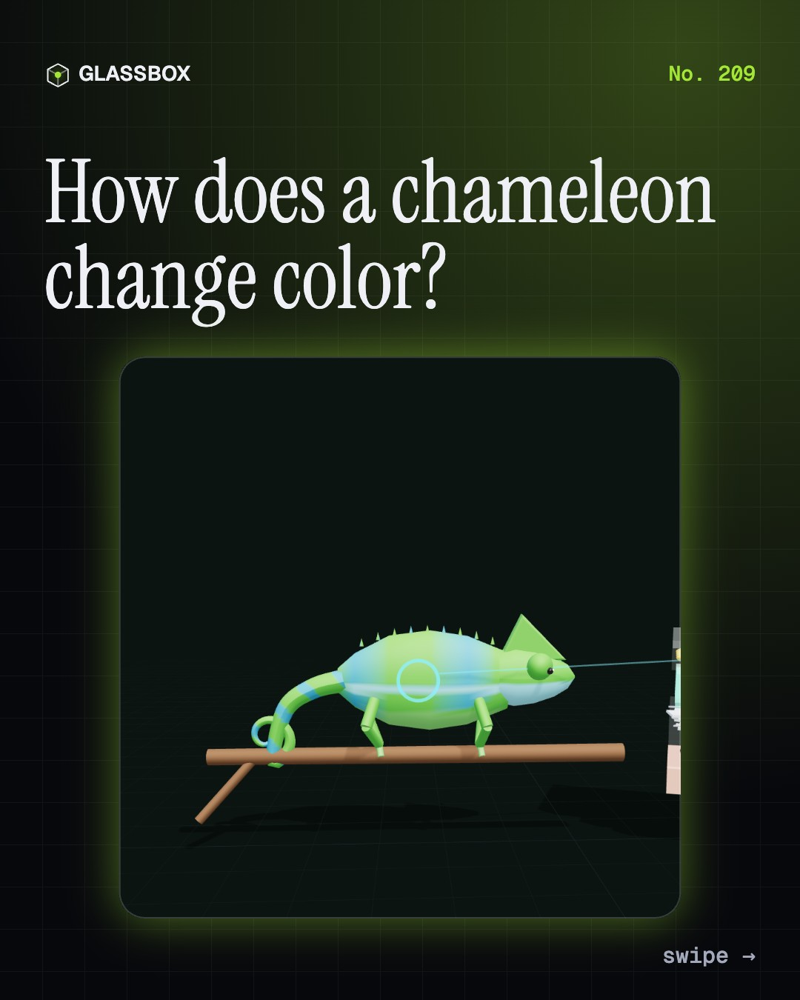
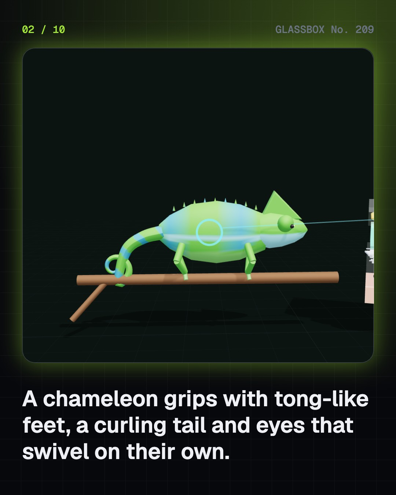
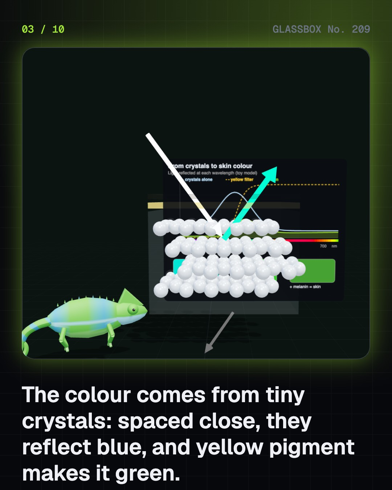
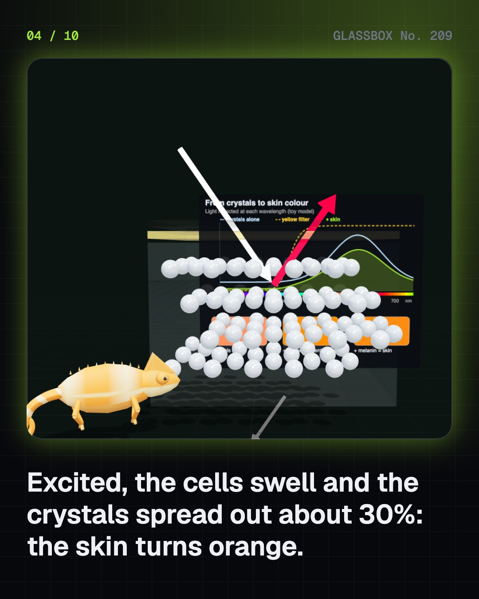

<!-- glassbox:start -->
<!-- Generated from glassbox.json by the Glassbox hub (npm run readme -- chameleonclear). Edit glassbox.json, not this block. -->
<p align="center"><a href="https://glassbox.how/e/chameleonclear/"></a></p>

<h1 align="center">ChameleonClear</h1>

<p align="center"><b>How does a chameleon change color?</b><br>A chameleon’s green is not paint. It is light bouncing off a lattice of crystals far smaller than a hair, and when a male gets excited the crystals spread apart and he turns orange. Slide the crystals and watch.</p>

<p align="center"><a href="https://glassbox.how/chameleonclear/"><b>▶ Play with it</b></a> &nbsp;·&nbsp; <a href="https://glassbox.how/e/chameleonclear/">Read the 60-second explainer</a> &nbsp;·&nbsp; <a href="https://glassbox.how/chameleonclear/glassbox/reel.mp4">Watch the 40-second video</a></p>

<p align="center">
  <a href="https://glassbox.how/e/chameleonclear/"></a>
  <a href="https://glassbox.how/e/chameleonclear/"></a>
  <a href="LICENSE"></a>
  <a href="LICENSE-CONTENT.md"></a>
  <a href="#privacy"></a>
</p>

## In 60 seconds

1. **A skin built in layers.** Under a chameleon’s clear outer skin sit yellow pigment cells, then two layers of crystal-filled iridophores, then dark melanophores with arms reaching up. It also has tong-like feet, a gripping tail, turret eyes that swivel on their own and a spring-loaded tongue.
2. **Colour from crystals.** Guanine crystals about 127 nm across sit in a neat lattice. Light reflected from layer after layer adds up for one colour only. Close together they reflect blue, which looks green through the yellow pigment. Excited males spread the crystals about 30% further apart, and the skin turns yellow and orange.
3. **Talking, not hiding.** Chameleons do not copy their background. Rival males flash bright colours and the brighter, faster-changing one tends to win; females say yes or no with colour; chameleons darken to warm up in the sun and sleep pale. Octopus and cuttlefish change faster, using muscles.
4. **India’s chameleon.** India has one chameleon, Chamaeleo zeylanicus, in scrub and dry forest across the peninsula. The red-headed garden lizard many call a chameleon is an agamid whose breeding colours come mostly from pigment.
5. **Chameleons and people.** The Indian chameleon is in Schedule I of the Wild Life (Protection) Act after the 2022 amendment, so catching or trading one is a crime. Almost half the world’s 200-plus species live only in Madagascar, including a nano-chameleon 13.5 mm long.
6. **How we found out.** Aristotle thought chameleons changed colour by puffing up with air. Brücke and Bert found colour cells and the nerves that steer them in the 1800s. In 2015 a Geneva team found the tunable crystal lattice, and engineers now copy it.

## Words worth knowing

| Term | Meaning |
|---|---|
| **Chromatophore** | A colour cell in the skin; chameleons have pigment cells, crystal cells and melanin cells in layers. |
| **Iridophore** | A cell holding tiny reflecting crystals of guanine instead of pigment. |
| **Structural colour** | Colour made by the size and spacing of tiny structures rather than by pigment. |
| **Photonic crystal** | A regular lattice with spacing near the wavelength of light that reflects one band of colour. |
| **Interference** | Waves adding where crests meet crests and cancelling where crests meet troughs. |
| **Melanophore** | A cell that moves dark melanin up its arms to darken the skin. |
| **Xanthophore** | A yellow pigment cell that filters out blue light, turning reflected blue into green. |
| **Signalling** | Sending a message to another animal; the main reason chameleons change colour. |
| **Zygodactyl** | Toes grouped in two opposing bundles that grip a branch from both sides. |

## A short history

**From Aristotle’s puff of air to nerves, pigment cells, and the nanocrystals found in 2015.**

- **350 BCE** · Colour from a puff of air (Aristotle, Athens)
- **77** · “Every colour except red and white” (Pliny the Elder, Rome)
- **1852** · Live chameleons from Cairo (Ernst Wilhelm von Brücke, Vienna)
- **1876** · Nerves steer the colour (Paul Bert, Paris)
- **2008** · Colour change evolved for talking (Devi Stuart-Fox and Adnan Moussalli, Melbourne and Cape Town)
- **2015** · The colour is in the crystals (Jérémie Teyssier, Suzanne Saenko, Dirk van der Marel and Michel Milinkovitch, Geneva)
- **2022** · Schedule I for India’s chameleon (Parliament of India, New Delhi)

The full story, with 24 moments, charts, people and 32 sources: [glassbox.how/e/chameleonclear/history](https://glassbox.how/e/chameleonclear/history/). The data lives in [`history.json`](history.json).

## Video and slides

Made with the Glassbox studio from this box's storyboard (`window.glassbox.director`). Free to reuse under CC BY 4.0.

<a href="https://glassbox.how/chameleonclear/glassbox/video.mp4"></a>

<p><a href="glassbox/slide-1.jpg"></a> <a href="glassbox/slide-2.jpg"></a> <a href="glassbox/slide-3.jpg"></a> <a href="glassbox/slide-4.jpg"></a></p>

| File | What | Size |
|---|---|---|
| [`glassbox/reel.mp4`](https://glassbox.how/chameleonclear/glassbox/reel.mp4) | Reel / Short, with captions and soundtrack | 1080×1920 |
| [`glassbox/video.mp4`](https://glassbox.how/chameleonclear/glassbox/video.mp4) | YouTube video, with captions and soundtrack | 1920×1080 |
| `glassbox/slide-1…10.jpg` | Instagram carousel | 1080×1350 |
| `glassbox/thumb.jpg` | YouTube thumbnail | 1280×720 |
| `glassbox/cover.jpg` | Share card and repo social preview | 1200×630 |
| [`glassbox/history-reel.mp4`](https://glassbox.how/chameleonclear/glassbox/history-reel.mp4) | “History in 10 moments” Reel / Short | 1080×1920 |
| `glassbox/history-slide-*.jpg` | History carousel | 1080×1350 |
| `glassbox/post.json` | Post copy and schedule used by the publish kit | |

## Privacy

This box has no accounts and no ads, and it ships its own fonts and libraries. When you run it yourself it sends nothing anywhere. On glassbox.how, the site's `/bar.js` also loads Glassbox's analytics: **Google Analytics** to count visits (it asks first in the EU, UK and Switzerland, and stays off when your browser sends Global Privacy Control or Do Not Track) and **ClickTrust** to detect bots.

It remembers a few things **in your own browser only**, and never sends them anywhere:

| Browser storage key | What it holds |
|---|---|
| `chameleonclear.v1` | Which chapters you have opened, your best quiz scores, and sound on or off. |

Exactly what each one sees is at [glassbox.how/privacy](https://glassbox.how/privacy/).

## Licences

- **Code:** [MIT](LICENSE). Use it, change it, ship it.
- **Explanations, text, images and videos** (`glassbox.json`, `glassbox/`): [CC BY 4.0](LICENSE-CONTENT.md). Credit “Glassbox, glassbox.how/e/chameleonclear”.
- **Third-party parts** keep their own licences: [three.js](https://threejs.org) (MIT), [Geist, Instrument Serif](https://openfontlicense.org) (SIL OFL 1.1).
- The Glassbox name and logo aren't covered by either licence. See the [terms](https://glassbox.how/terms/).

Found a mistake? [Open an issue](https://github.com/bdeeps/chameleonclear/issues). Corrections happen in public.
<!-- glassbox:end -->

## Run it

It's plain HTML, CSS and JavaScript. No build step and no dependencies. Run locally, it contacts no other website.

```bash
python3 -m http.server 8000
```

Three.js and the fonts ship in `vendor/` and `fonts/`, so it also works offline.

Then open http://localhost:8000.

## How it's built

| File | What |
|---|---|
| `index.html`, `css/app.css` | The page and its styles |
| `js/app.js`, `js/stage.js`, `js/ui.js`, `js/kit.js` | The shared Glassbox 3D engine: chapters, 3D stage, controls, quiz, video director |
| `js/chapters/*.js` | One file per chapter: the 3D model, controls, text, key terms, quiz and video scenes |
| `js/cham.js` | The skin-colour model (photonic crystal, pigments, CIE colour), the sunlight model, the procedural chameleon and garden lizard, the cut-open skin and chart boards |
| `glassbox.json` | Title, question, explainer beats, key terms, browser storage and credits shown on glassbox.how |
| `reel` in each chapter | The storyboard the Glassbox studio records into short videos |
| `glassbox/` | The published video, slides, thumbnail and post copy |
| `fonts/`, `vendor/three/` | Self-hosted Geist and Instrument Serif (SIL OFL 1.1) and three.js (MIT) |
